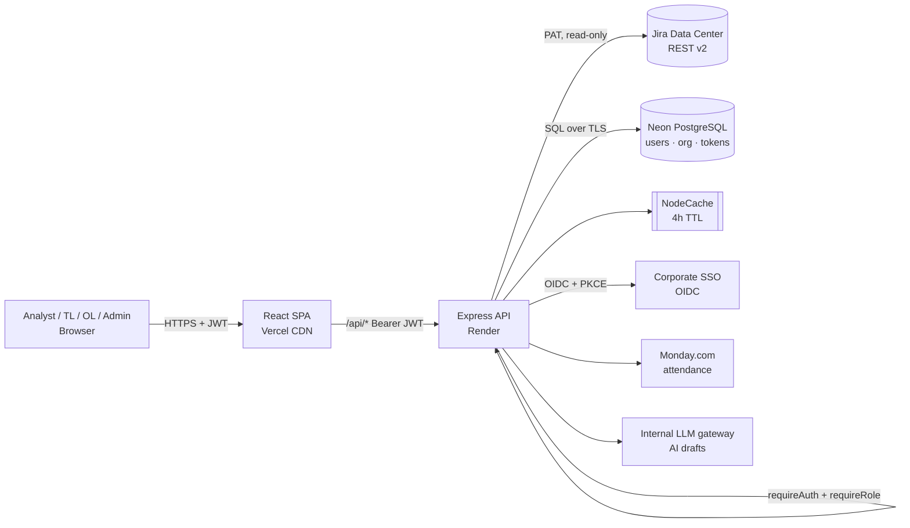
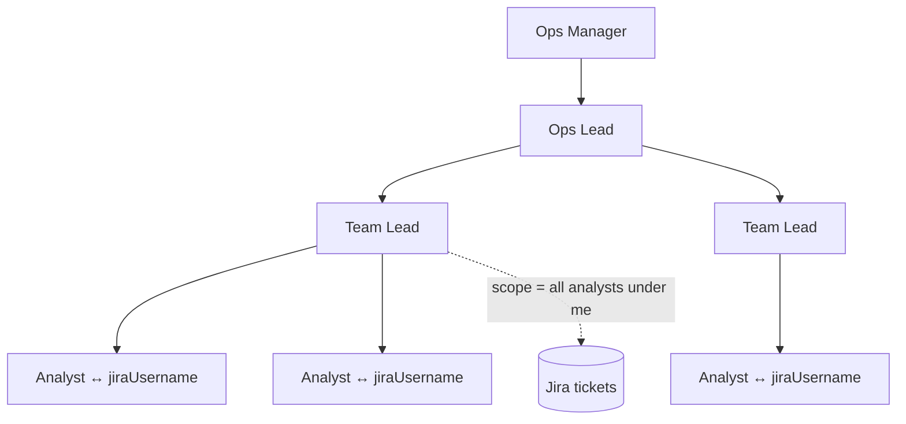
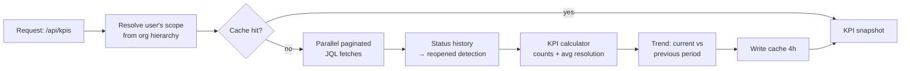
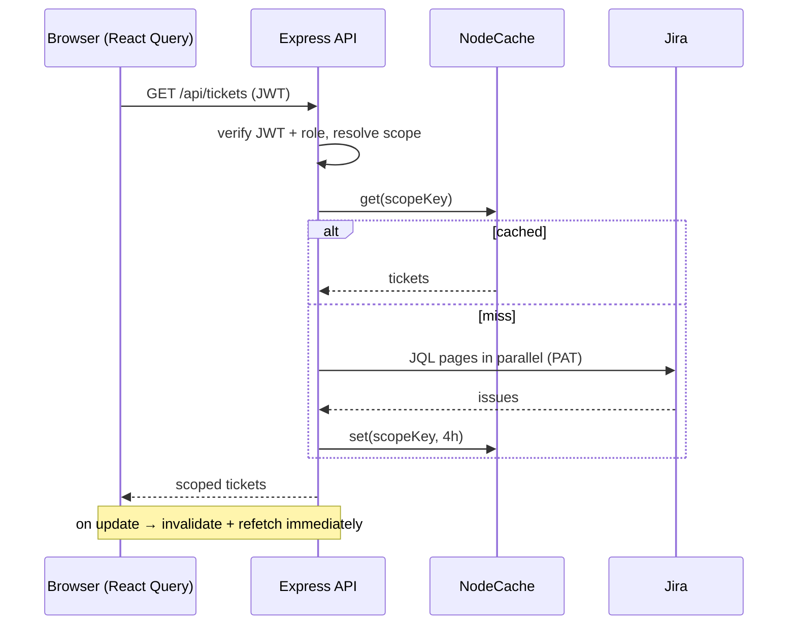
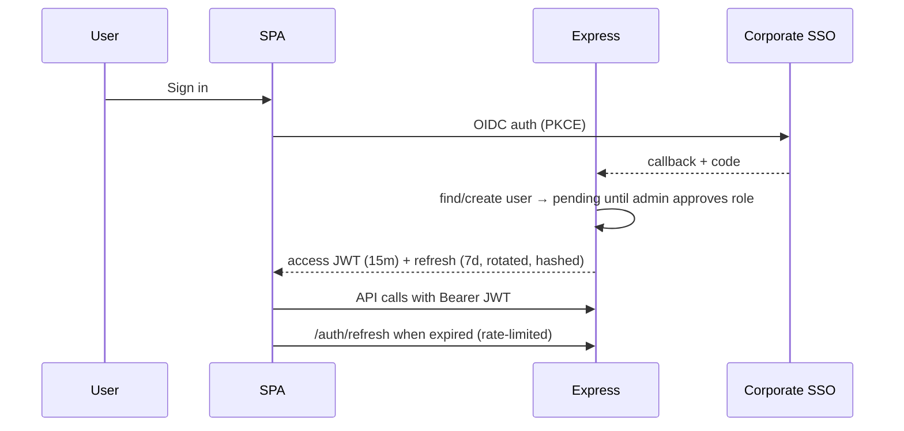

# Case Study Draft — Pulse

> **Status:** DRAFT for review. Nothing in the live portfolio has changed yet.
> No open placeholders left in the result section. Time figures are your own estimates, not measurements.
> **Decisions:** names anonymized · replaces the "Pulse Analytics" placeholder card in `projects.json` · Remotion video (60–90s) to be built after the draft and screenshots are approved.

---

## 1. Title + one-line result

**Pulse: a Jira productivity dashboard that fits each role**

*One line:* Replaced manual Jira-to-Excel reporting with a dashboard for each role that shows every analyst, team lead and ops lead their KPIs within seconds of logging in. Saves each team lead roughly 3–5 hours a week of manual reporting, for about 100 regular users across 10–20 teams.

Card fields for `projects.json`:

| Field | Proposed value |
|---|---|
| `name` | Pulse |
| `tag` | Ops Dashboard |
| `desc` | A Jira productivity dashboard that shows every role its own numbers, with no JQL needed. |
| `stack` | React, TypeScript, Express, PostgreSQL, Recharts |

---

## 2. The problem

An operations team handles its support tickets in Jira Data Center. There are four layers of people: analysts, team leads, ops leads and ops managers. Each layer needed a different view of the same tickets, and none of them had one.

- **Analysts** exported Jira data to Excel to see their own queue and how it was trending.
- **Team leads** spent hours each week building team reports by hand to see who was overloaded or sitting on urgent tickets.
- **Ops leads** had no view across teams. Comparing teams meant asking each lead for their spreadsheet.
- **There was no history.** Nobody could answer "is my backlog getting better or worse than last month?"
- **Replies to clients** took 20–30 minutes each to draft.
- **Attendance** lived on a separate Monday.com board, which meant another tab and another login.

Jira had the data. It didn't have the org structure (who reports to whom), and it expected every user to write JQL.

---

## 3. The goal

Build one internal tool where:

1. **Every user sees only what their role needs** within seconds of logging in.
2. **Trend arrows show which way the queue is moving** (this 30 days vs. the previous 30) without anyone drilling in.
3. **Leads can check team health without calling a meeting.**
4. **Credentials stay safe.** The Jira token never reaches the browser, and roles are enforced on the server, not just hidden in the UI.
5. **It costs nothing to run.** No new paid infrastructure for an internal tool.

---

## 4. Tools and timeline

**Timeline:** started 28 Jul 2026. The first full release was ready by the end of Aug 2026 (about 5 weeks and 71 commits). Since then it has been in iterative improvement through Nov 2026: 91 commits in total across about 4 months.

| Phase | Dates | What shipped |
|---|---|---|
| Discovery & design | Late Jul | Product definition, role map, design system (enterprise-style, Carbon-inspired), Excalidraw architecture |
| Core build | Jul 30 – Aug | Four role dashboards, Jira proxy, KPI engine, JWT auth + RBAC, admin panel, deploy |
| Integrations | Aug | Enterprise SSO (OIDC + PKCE), Monday.com attendance, LLM-powered email composer & assistant |
| Iteration | Sep – Nov | Customizable dashboard card layouts, attendance alerts, team transfers, lead reporting, cache fixes |

**Stack**

| Layer | Tools |
|---|---|
| Frontend | React 18, TypeScript, Vite, Tailwind CSS, Radix UI, Recharts, React Query, Zustand, dnd-kit |
| Backend | Node.js, Express, TypeScript, node-postgres, Axios, JWT, bcrypt, NodeCache, openid-client |
| Data | Jira Data Center REST v2 (read-only), Neon PostgreSQL |
| Integrations | Corporate SSO (OIDC), Monday.com API, internal LLM gateway |
| Infra | Vercel (frontend), Render (API), Neon (DB), Docker Compose (local), all on free tiers |
| Quality | Vitest, MSW, React Testing Library (24 test suites) |

**Scale of the build:** about 21k lines of frontend TypeScript, about 8k lines of backend, 20 pages, 30+ API endpoints, 3 external integrations.

---

## 5. How I did it

### 5.1 Started from the people, not the data
I mapped the four roles and wrote down the single question each one opens the app to answer:
- Analyst: *"What's in my queue and am I keeping up?"*
- Team lead: *"Who on my team needs help today?"*
- Ops lead: *"Which team is falling behind?"*
- Admin: *"Who has access to what?"*

Every screen exists to answer one of those questions. Anything that didn't answer one was left out.

### 5.2 Put a secure proxy in front of Jira
The browser never talks to Jira. An Express backend holds the Jira Personal Access Token, checks the user's JWT and role, decides which tickets that user is allowed to see, and only then calls Jira.
→ **Figure B: System architecture**

### 5.3 Taught the dashboard the org chart
Jira knows tickets and usernames. It doesn't know that Analyst A reports to Team Lead B under Ops Lead C. I modeled the hierarchy in PostgreSQL (Ops Manager → Ops Lead → Team Lead → Analyst) and mapped each person to their Jira username. A team lead's dashboard is then simply "tickets assigned to anyone under me".
→ **Figure C: Org hierarchy / data model**

### 5.4 Built a KPI engine on top of raw tickets
The backend pulls each user's tickets with parallel paginated Jira requests. It then calculates active, closed, urgent, waiting/pending, high-priority, reopened and average resolution time. **Reopened** tickets come from each ticket's status history, not from a field, because Jira has no "reopened" flag. Each metric compares the current 30 days with the previous period to produce the trend arrow.
→ **Figure D: KPI data flow**

### 5.5 Made it fast without hammering Jira
A 4-hour cache-aside layer (NodeCache) sits in front of Jira, and React Query caches on the client. Repeat visits return instantly, and the tool keeps working through short Jira outages. When something changes (a ticket update, an attendance entry), the related queries are invalidated straight away so nobody sees stale numbers.
→ **Figure E: Request + cache sequence**

### 5.6 Enterprise-grade auth on a free stack
- Two-token JWT (15-minute access token, 7-day refresh token with rotation), with refresh tokens stored as hashes.
- Corporate single sign-on through OIDC with PKCE.
- Role checks in server middleware on every route.
- Rate limiting on login (10 per 15 minutes) and refresh (60 per 15 minutes), bcrypt for passwords, CORS locked to the frontend's origin.
- New users self-register and wait in a *pending* state until an admin approves their role.
→ **Figure F: Authentication flow**

### 5.7 Added AI where it saves real time
The LLM-powered email composer drafts client replies from the ticket's context. The analyst always edits and approves the draft, and nothing is written to Jira automatically. A floating assistant answers quick questions.

### 5.8 Designed for daily use
I used a Carbon-inspired enterprise design system with dark and light modes, KPI cards that count up, and a slide-over ticket panel showing comments, worklogs and status history. In later releases each user can rearrange and save their own dashboard card layout.

### 5.9 Built against mock data, shipped against real data
A `VITE_USE_BACKEND` flag switches the whole frontend between seeded mock data and the live API. That let UI work and testing run without Jira access, and it is how every screenshot in this case study was captured (no live data shown).

---

## 6. The result

| Before | After |
|---|---|
| Manual Jira → Excel exports | KPIs live on login, with no exports |
| Team reports compiled by hand (about 3–5 hours a week per team lead) | Team view is generated automatically |
| No cross-team view | One ops lead dashboard across all teams |
| No trend history | 30-day vs. previous-period trends on every KPI, plus weekly, bi-weekly and monthly charts |
| Client email drafts took 20–30 min | AI draft in 2 clicks, then human edit: about 2–5 min |
| Attendance on a separate Monday.com board | Attendance built into Pulse, with daily completion alerts |
| — | **$0/month** extra infrastructure cost |

Adoption: about **100 regular users**, in an operations organization of up to **400 people, analysts included**, across four roles and roughly 10–20 teams.

---

## 7. What to improve

- **Cold starts.** The free Render tier sleeps after 15 minutes idle, so the first load of the day is slow. The fix is a $7/month always-on instance or a keep-alive ping.
- **End-to-end tests.** There is unit and integration coverage, but no automated browser E2E tests yet. Playwright would be next.
- **Audit logging.** Admin actions aren't logged yet, and compliance will want that.
- **Write-back to Jira.** Pulse is read-only on purpose. Posting approved replies and assigning tickets from Pulse would close the loop once Jira write permissions are approved.
- **Real-time updates.** It currently refreshes through cache invalidation. WebSockets would remove the need to refresh.
- **SLA tracking and forecasting.** Once there are 6+ months of history, the next step is alerts on SLA breaches and ticket-volume forecasting.

---

## Visual plan (proof for the client)

### System design figures (I'll redraw these in the portfolio's style)
The source repo already has Excalidraw sources in `docs/diagrams/` (system architecture, auth flow, KPI data flow, org hierarchy, API route map, component tree). I'll re-export them as clean SVGs. Below are the drafts:

**Figure B: System architecture**

**Figure C: Org hierarchy → Jira scope**

**Figure D: KPI data flow**

**Figure E: Request + cache sequence**

**Figure F: Authentication flow**

### Graphs (honest data only)
| Graph | Data source | Notes |
|---|---|---|
| **Build timeline**: commits per month (Jul 8 · Aug 63 · Sep 2 · Oct 2 · Nov 16) | Git history, real | Shows the 5-week sprint, then the iteration phase |
| **Before/after time per task**: report compilation, email drafting | Your estimates: team report 3–5 hrs/week → automatic; client email 20–30 min → 2–5 min | Labelled as estimates, not measured |
| **Feature scope by role**: which capabilities each role gets | Code, real | Small matrix or heatmap |
| **Monthly running cost**: $0 vs. a typical paid BI tool | Real ($0) | Optional; only useful if you want to stress cost |

### Screenshot shot list (mock mode only, no live data)
Captured from a local build with `VITE_USE_BACKEND` unset, so every number comes from seeded fixtures.

1. Login / SSO screen
2. **Analyst dashboard**: KPI cards with trend arrows, productivity chart, recent tickets
3. **Team lead dashboard**: analyst mini-cards
4. **Ops lead dashboard**: cross-team overview
5. Ticket slide-over: comments, worklogs, status history
6. AI email composer with a draft
7. Attendance page
8. Customizable dashboard card layout (drag in progress)
9. Admin panel: user and role management
10. Dark vs. light mode side by side

⚠️ **The mock data is not anonymous yet.** The fixtures are generated from `org-mapping.json`, which contains real colleague names, and the mock tickets name a real client. Before any screenshot, I'd swap in a fake org file (fake names, "Client A/B") for the demo build only, without changing the real file.

### Optional: video explainer
A 60–90 second walkthrough built with **Remotion** (videos written as React code): an animated architecture diagram, then mock-mode screen recordings for each role, then the before/after numbers. This needs Remotion added as a dev tool in a separate folder. Say the word and I'll set it up after the written case study is approved.
